# lanes

[](https://github.com/senaiverse/lanes/actions/workflows/ci.yml)
[](LICENSE)
[](https://code.claude.com/docs/en/plugins)



One AI session plans. Several others build in parallel. When a builder's memory fills up, it writes a note, gets
wiped, and carries on from that note.

lanes is a plugin marketplace for [Claude Code](https://code.claude.com/docs), Anthropic's coding assistant for the
terminal. It runs several Claude sessions side by side in tmux and keeps their work on track.

> **Status: v0.1 in progress.** Today you can install `lanes-plancheck`, `lanes-jobs`, `lanes-review` and
> `lanes-prodfence`. The core plugin (`lanes`), `lanes-guards` and `lanes-waves` are marked "coming in v0.1" below.
> This README says "v0.1 preview" wherever a description depends on a piece that is not released yet.

## Contents

- [What is this, in plain words](#what-is-this-in-plain-words)
- [Who it is for, and who it is not for](#who-it-is-for-and-who-it-is-not-for)
- [How it compares](#how-it-compares)
- [Install](#install)
- [A five-minute walkthrough](#a-five-minute-walkthrough-v01-preview)
- [The failure modes lanes handles](#the-failure-modes-lanes-handles)
- [Files lanes uses](#files-lanes-uses)
- [Contributing](#contributing)
- [Credits](#credits)
- [License](#license)

## What is this, in plain words

Picture a building site. A site lead decides what gets built and in what order. A crew of workers builds it. Each
worker has a limited amount of working memory, like a notebook with a fixed number of pages. When the notebook is
nearly full, a good worker does not push on and start forgetting things. The worker writes a handover note, empties
the notebook, reads the note, and keeps going. The lead checks that the note exists before the notebook is emptied.

lanes gives AI sessions that same routine.

```
   you
    |
    v
  LEAD  ---- writes the plan, hands out the work, watches the crew
    |
    +--> LANE A  ---- builds one piece in its own copy of the code
    |
    +--> LANE B  ---- builds another piece in its own copy of the code
              |
              v
          JOURNAL  ---- plain files in the repo: the plan, the state, the RESUME note
              |
   a lane reaches 70% full
              |
              v
      lead asks for a RESUME note --> lane writes it --> lead clears the lane (/clear)
              |
              v
      the lane wakes empty, reads its RESUME note, and resumes
```

### The words, once

- **Session.** One running copy of Claude Code, one conversation.
- **Lead.** The session that plans and checks. It decides, and it does not build.
- **Lane.** A session that builds one piece of work. Each lane works in its own checkout of the code, so lanes do not
  overwrite each other.
- **tmux.** A terminal program that keeps many terminal windows ("panes") alive side by side, even when you close the
  screen. Each session runs in its own pane. lanes needs it to find and drive the sessions.
- **Context window.** A session's working memory. Everything it has read and said in this conversation sits in it. It
  has a fixed size. As it fills, the session gets slower and starts to lose details.
- **`/clear`.** A Claude Code command that empties the context window. The session keeps running but remembers
  nothing.
- **Journal.** A folder of plain text files in your repository (default `.lanes/`). It holds the plan, the list of work
  items, and each lane's notes. It is the shared memory that survives a `/clear`.
- **RESUME note.** A short section at the top of a lane's journal file: what I did, what is half done, what I do next.
  After a `/clear` the lane reads it and picks up the work.
- **Hook.** A small script that Claude Code runs on an event, such as "a session just started" or "a tool is about to
  run". lanes uses hooks to re-inject the RESUME note after a clear and to refuse a few risky commands.
- **Plugin.** A package of skills, hooks, scripts and agents that you add to Claude Code.
- **Marketplace.** A catalogue of plugins that Claude Code can install from. This repository is one.

### Why it helps

- A long task survives many context-window fills. The lane forgets nothing the note carries.
- You do not decide when to clear. The lead sees the fill level and runs the handover.
- A lane is cleared only when it is idle, its work is saved and pushed, and its note is fresh. Clearing a lane in the
  middle of a thought loses work. lanes refuses to do that.
- With `lanes-guards`, parallel lanes cannot trample each other by mistake: only the lead dispatches CI and merges,
  and lanes do not edit the main checkout.
- All state is plain text in your repository. You can read it, diff it, and fix it by hand.

## Who it is for, and who it is not for

**For you if:**

- You already use Claude Code in a terminal, and you run, or want to run, more than one session on one repository.
- Your tasks last longer than one context window: multi-day features, large refactors, release work.
- You are comfortable with git, branches and a shell. A lane's work lands on a branch you review.

**Not for you if:**

- You use Claude Code only through a desktop app or an editor extension. lanes drives sessions through tmux, and
  tmux is the only supported way to run them.
- You want a one-click graphical tool. lanes is scripts and skills.
- You want a sandbox. The guards catch mistakes, not attacks (see below).

**Honest limits:**

- **tmux only.** lanes sends `/clear` and the goal to a session by typing into its tmux pane.
- **Linux, macOS and WSL.** On native Windows, only `lanes-plancheck` is supported, through Git Bash (Git for
  Windows), which is what Claude Code uses to run hooks there. CI runs its suite on Windows. Everything that needs tmux
  needs WSL on Windows, and so does `lanes-prodfence`, whose hooks run a Bash script.
- **Bash 4+ and jq.** Every script runs on Bash and jq only. macOS ships Bash 3.2, so run `brew install bash` first.
- **The guards are mistake guards, not a sandbox.** They refuse a lane that runs a lead-only command, and they say
  why. A determined session can still reach around them. The reviewer agent is instructed not to edit, and it is not
  sandboxed either. For a hard limit, use Claude Code's permission rules.
- **Destructive commands are out of scope.** For `rm -rf` or `git reset --hard`, install
  [destructive_command_guard](https://github.com/Dicklesworthstone/destructive_command_guard) or
  [cc-safety-net](https://github.com/kenryu42/claude-code-safety-net). lanes does not duplicate them.
- **Claude Code 2.1.224 or later** for the built-in messaging between sessions. The platform facts lanes relies on
  were checked by experiment on 2.1.308 (`docs/M0-FINDINGS.md`).

## How it compares

The tools below solve neighbouring problems. The table says what each does, from their documentation and from the
code we read, and where lanes differs.

| Tool | What it does | What lanes adds |
|---|---|---|
| [claude-squad](https://github.com/smtg-ai/claude-squad) and similar session managers (ccmanager, vibe-kanban) | Start and switch between many agent sessions, often one git worktree each. | A lead that plans, a journal, and a clear that happens at a threshold and resumes. These tools manage sessions and do not clear and resume them. |
| Anthropic's agent teams | A lead session coordinates teammate sessions, with built-in messaging. | Resuming. Agent teams cannot resume a teammate. lanes uses the same native messaging and adds the journal and the handshake. |
| [Tmux-Orchestrator](https://github.com/Jedward23/Tmux-Orchestrator) | An orchestrator agent runs worker agents in tmux and schedules check-ins. | Context awareness. Its check-ins run on fixed timers, and it has no context threshold. It sends keys with no busy check and no check that Enter landed. |
| [Continuous-Claude](https://github.com/parcadei/Continuous-Claude-v3) | At 85% full it asks the model to write a handoff file. A hook restores it after `/clear`. | Orchestration. A human types `/clear`. It does not check that the session is idle, clean and pushed, and it is built for one session. |
| [destructive_command_guard](https://github.com/Dicklesworthstone/destructive_command_guard), [cc-safety-net](https://github.com/kenryu42/claude-code-safety-net) | Block destructive commands such as `rm -rf` and `git reset --hard`. | Nothing. lanes' guards cover a different job: which session may run which command. Use both. |

What nothing we found covers (landscape check, 2026-10-22, in `docs/DECISIONS.md`):

- A lead that clears lanes at a context threshold and resumes them from a structured journal.
- A tmux job pane pool with STATUS files.
- Release waves: theme branches, an integration branch, one merge.

The feature request for a context-threshold handoff in Claude Code itself
([anthropics/claude-code#50978](https://github.com/anthropics/claude-code/issues/50978)) was closed by the stale
bot, not by a maintainer. lanes works with today's Claude Code and needs no change in it.

What lanes will not do: sandbox a session, guard against destructive commands, run its tmux plugins on native
Windows, or clear a lane without the handshake.

## Install

This repository is a marketplace named `lanes` that holds several plugins. Inside Claude Code, add the marketplace
once, then install each plugin you want by its name. The form is `/plugin install <plugin>@<marketplace>`, so the
core reads `lanes@lanes`. Requirements: tmux, jq and Bash 4+.

```
/plugin marketplace add senaiverse/lanes

# The core: the lead and lane workflow (coming in v0.1)
/plugin install lanes@lanes

# Optional, pick what you need
/plugin install lanes-guards@lanes      # lead-only commands and plans; needs the core (coming in v0.1)
/plugin install lanes-waves@lanes       # release waves; needs the core (coming in v0.1)
/plugin install lanes-jobs@lanes        # long commands in a tmux job pool; works alone (available now)
/plugin install lanes-review@lanes      # adversarial reviewer agent; works alone (available now)
/plugin install lanes-prodfence@lanes   # production fence; works alone (available now)
/plugin install lanes-plancheck@lanes   # plan field checker; works alone (available now)
```

| Plugin | What it does | Required? | Status |
|---|---|---|---|
| `lanes` | The core: lead and lane skills. Lanes on a `/goal` in tmux, cleared at a context threshold, resumed from a RESUME block. | Required for the lead and lane workflow | Available |
| `lanes-jobs` | A skill: run heavy commands in a shared tmux server and read the result from a STATUS file. | Optional, works alone | Available |
| `lanes-review` | An adversarial reviewer agent for a branch range or a pull request. Instructed not to edit; not sandboxed. | Optional, works alone | Available |
| `lanes-prodfence` | The production fence: refuses any session's tool call that mentions a configured production marker or protected path, so only the human acts on production. A mistake fence, not a sandbox. | Optional, works alone | Available |
| `lanes-plancheck` | A skill: check that a plan file carries its required fields before a lane builds it. | Optional, works alone | Available |

The plugins are skills: instructions the sessions follow with plain `tmux`, `git` and `claude` commands. Only
`lanes-prodfence` carries a script, because refusing a tool call needs a hook.

<details>
<summary>Requirements and the Bash 3.2 note on macOS</summary>

- **tmux**, any recent version.
- **jq.**
- **Bash 4 or later.** macOS ships Bash 3.2. Install a newer one with `brew install bash`. Each lanes script checks the
  version first and stops with a one-line message if it is too old.
- **git**, and `gh` if you use `lanes-waves` or `lanes-review` with pull requests.
- **Claude Code 2.1.224 or later.**
- Linux, macOS, or WSL.

</details>

## A five-minute walkthrough (v0.1 preview)

This is a typical day once the core is released. Every step marked preview depends on a piece that is not available
yet. Steps without a mark use only what ships today.

**1. Start the lead and two lanes (v0.1 preview).** Open three tmux panes in your repository. In each, start Claude
Code with a name:

```
claude --name lead
claude --name lane-api
claude --name lane-ui
```

Each session registers itself in a small file, so the lead knows which pane is which lane. The lead and the lanes
use the lead and lane skills.

**How many lanes?** Any number: there is exactly one lead, and every other named session is a lane. To add one, open
a pane and start `claude --name <new-lane>`; nothing to configure. Two to four lanes is a good start. Past about five,
merge conflicts between lanes and the lead's review load tend to cost more than the extra parallel work gains.
Heavy commands are capped separately: `lanes-jobs` runs at most two at once across all panes by default
(`LANES_POOL_SIZE`).

**2. Plan (v0.1 preview).** You tell the lead what you want. The lead asks you questions one at a time, each with a
recommended answer. When the plan is clear, it writes the work into the journal as items, one per lane. Before a
lane starts, `lanes-plancheck` confirms the plan has its goal, its "done when" and the rest. This step works today if
you use `lanes-plancheck` alone.

**3. Build (v0.1 preview).** The lead messages `lane-api` and `lane-ui` with their items. Each builds in its own
checkout, writes tests first, keeps its RESUME note current, and reports "done" with a short report: what else it
touched, how far the change reaches, the pitfalls, and the edge cases with their tests. The lead reads the full diff
before it accepts.

**4. A lane reaches 70% (v0.1 preview).** The status line records each lane's fill level. The lead runs
`lanes status` and sees `lane-api` at 72%. The threshold is 70% by default and you can change it.

**5. The handshake (v0.1 preview).**

1. The lead asks `lane-api` to write its RESUME note.
2. The lane finishes its step, commits, pushes, and writes the note.
3. The lane runs `lanes clear-ready`. The command refuses unless the working tree is clean, the head is pushed, and the
   note is fresh and complete.
4. The lead runs `lanes clear lane-api`. The command refuses unless the lane is idle and unchanged since it said it
   was ready.
5. The lead sends `/clear` and the lane's goal to the pane, and checks that both landed.

**6. The resume (v0.1 preview).** The cleared lane starts again with an empty window. A hook that runs when a session
starts after a clear puts the lane's RESUME note and goal back in front of it. `lane-api` reads "next: add the
retry test for the upload route" and does that. You did not retype anything.

**7. Finish.** The lanes push their branches. For a release, `lanes-waves` merges the branches onto one integration
branch, opens review pull requests by area, and merges once (v0.1 preview). The lead is the only session that
dispatches CI or merges. `lanes-guards` enforces that and names the rule when it refuses (v0.1 preview).

If you leave the keyboard, tell the lead you are away. In away mode (v0.1 preview) it stops asking you questions with
the ask tool. It queues them in `.lanes/morning.md` until you say you are back.

## The failure modes lanes handles

These come from reading how other tools fail (`docs/research/prior-art-handoff.md`). This is the core's design
(v0.1 preview): each one has a named test, run against a real tmux server, in the core plugin's suite. The ranking is
damage times likelihood.

1. **`/clear` reaches a busy session.** The clear is either queued as plain text for the model, or it wipes work in
   progress. lanes re-checks that the lane is idle at the moment it sends, twice, with a pause between.
2. **Something happens between "ready" and "clear".** The lead sends a follow-up, or a human types, and the clear
   discards that work. lanes refuses when the head commit, the working tree or the RESUME note changed after the
   lane said it was ready.
3. **A lost Enter.** The command sits in the input box, unsent, and the next message is glued onto it. lanes checks
   the effect (the session id changed after the clear), not that the typed text was seen on screen. It retries a
   bounded number of times and then fails loudly.
4. **The goal sent as a paste.** Claude Code does not run a slash command from a collapsed paste, and it gives no error
   (anthropics/claude-code#85654). lanes types the goal as one line in small pieces and checks that it shows as active.
5. **The RESUME note is dropped or cut short.** Claude Code caps hook text at 10,000 characters. lanes refuses a note
   that is too long when the lane writes it, and it keeps the hook fast and its output valid.
6. **The fill level is wrong or missing.** It can be empty early in a session, stale on an idle lane, or reset
   after a compaction. lanes keeps three states (a number, unknown, stale) and never reads unknown as zero.
7. **A new identity after `/clear`.** The session id changes on a clear. lanes keys each lane by its name and
   re-registers on every start, so the lead does not lose the lane or read the old session's number.
8. **Idle guessed from screen text.** Spinner words show up in ordinary prose, and a custom status line hides the
   footer hints. lanes tracks busy and idle with hooks and uses the screen only as a second check.
9. **The wrong target.** A `/clear` typed into a shell, the lead, or another lane. lanes addresses the pane by its
   id, checks that Claude Code runs in it, and refuses when the pane is in copy mode.
10. **A dialog is open.** Keystrokes answer a permission prompt instead of clearing. lanes refuses and says why.
11. **The RESUME note is missing or empty.** `lanes clear-ready` checks that the note is newer than the request, has
    its required sections, and names a next step.
12. **The lead dies mid-handshake.** The handshake keeps one record per lane, written atomically, so a restarted lead
    continues instead of clearing twice.

Where the research marked an answer open, the corresponding behaviour is tested against the real platform before
release.

## Files lanes uses

- `.lanes/RULES.md`: the mechanism rules of the core `lanes` plugin. `lanes-waves` requires it.
- `.lanes/tracker.md`: the item source `lanes-waves` reads by default.
- `.lanes/waves/W<N>.md`: a wave's plan table, by default.
- `.lanes/waves.md`: wave settings (template in `lanes-waves`).
- `.lanes/plan-fields`: optional override of the required plan fields (`lanes-plancheck`).

## Contributing

See [`CONTRIBUTING.md`](CONTRIBUTING.md) for the workflow and [`SCOPE.md`](SCOPE.md) for what lanes takes and what it
does not. Run `scripts/test.sh` before a push.

Decisions live in [`docs/DECISIONS.md`](docs/DECISIONS.md), the build order in
[`docs/PLAN-v0.1.md`](docs/PLAN-v0.1.md), and the shared conventions in
[`docs/CONVENTIONS.md`](docs/CONVENTIONS.md). Read them before you open a pull request.

## Credits

The grilling workflow the lead skill uses is from Matt Pocock's skills (https://github.com/mattpocock/skills, MIT).
lanes links to it and does not copy it. The handoff ideas (link instead of copy, redact secrets, name the next step)
and the repository and skill layout follow the same repository.

## License

[MIT](LICENSE)
